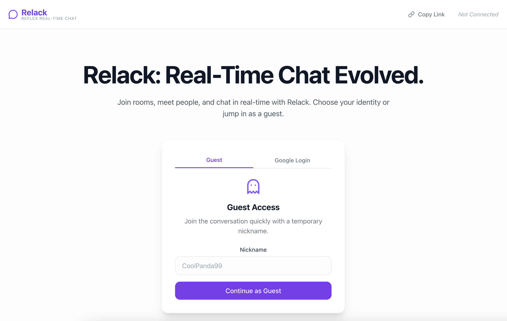

# Relack

**Relack** is a secure, self-hosted team communication platform built with [Reflex](https://reflex.dev/) and Python. It is designed to be a privacy-focused alternative to SaaS solutions like Slack.

## Motivation

As SaaS services like Slack continue to expand globally, they have become the standard for enterprise communication. However, this convenience comes with a cost: data sovereignty and confidentiality.

Many enterprises are increasingly concerned that storing sensitive internal communications and trade secrets on third-party servers—often located in different jurisdictions—exposes them to risks. These risks include potential access by foreign governments, data breaches, or unauthorized surveillance.

**Relack** was created to solve this problem. By providing a solution that can be fully self-hosted and controlled within your own infrastructure, Relack ensures that your organization's critical information remains private and secure, without sacrificing the modern chat experience.

## Architecture & Design

Interested in how Relack is built? Check out our [Project Design and Architecture Overview](docs/Relack%20Project%20Design%20and%20Architecture%20Overview.pdf).

## Features

- **Full Data Control**: You own your data. No third-party SaaS lock-in.
- **Pure Python**: Built entirely in Python using the Reflex framework, making it easy to customize and extend.
- **Modern UI**: Clean and responsive interface for seamless team collaboration.
- **Calls**: Start an audio call in any room or direct message; see [Calls](#calls).
- **Messages that stay**: every room keeps its whole history, with threads, reactions, editing and deleting, Markdown formatting, files and pictures, search, @mentions and notifications; see [Messages](#messages).

## Screenshots

### Authentication
Relack supports anonymous guest access for quick and easy collaboration.



### Main Interface
A full-featured chat interface with room management and real-time messaging.


## Messages

- **History**: rooms, messages, people, settings and logins are kept in a SQLite database, `relack.db`, so they survive restarts. A room opens with its latest 100 messages; **Load earlier messages** goes further back. Times show in each viewer's own time zone, with a divider where the day changes.
- **Writing**: Enter sends, Shift+Enter starts a new line (Enter never sends while an input method such as Zhuyin is still composing), and Enter inside a ` ``` ` block adds a line. Messages are Markdown: `**bold**`, `_italic_`, `~~strike~~`, `` `code` ``, ` ``` ` code blocks, `>` quotes and lists; the toolbar under the box (and Ctrl/Cmd+B, Ctrl/Cmd+I) adds the marks for you. Links show a preview as before.
- **Reactions, threads, edit, delete**: hover a message for quick reactions, the emoji picker, **Reply in thread** (replies open in a side panel; the message shows how many replies it has), and, on your own messages, **Edit** (shows "(edited)") and **Delete**. A deleted message that has replies stays as "This message was deleted." until its last reply goes.
- **Files**: attach files with the paperclip, paste a screenshot into the box, or drop files on the room. They wait above the box until you send. Pictures show in the message; other files as a card that downloads them. Files are stored under `uploaded_files/relack/` at unguessable addresses (anyone holding a link can open it). The limit is 200 MB per file (`RELACK_MAX_UPLOAD_MB`).
- **Search**: the box above the room list filters rooms as you type; Enter searches messages, files and people in every room you can see. Clicking a message opens it in its room (or thread), highlighted.
- **Mentions and notifications**: type `@` to pick someone (or `@here`, `@channel`, `@everyone` for everyone who has opened the room). Unread counts belong to the person, not the browser tab: the room list shows them (red for mentions and direct messages) and the tab title shows the total. Direct messages, mentions and replies in threads you started or replied in also bring a desktop notification and a sound; the bell above the room list turns them on or off for that browser.

A guest's nickname is their identity, so it can't contain `@` (Google accounts are their email address), be "System" (owner of the default rooms) or be a member's username. Room names starting with `dm-` are kept for direct messages. Import, export and approvals need the admin passcode.

Where `relack.db` lives: in the App Store, beside the app's `reflex.db` on its own volume (SQLite files must not be shared with the host); run locally, in `.relack/` (which the dev server's hot reload ignores). `RELACK_DB_PATH` sets another place. **Admin → Data Maintenance → Export Data** saves everything except the files themselves.

E2E suites:

```bash
poetry run ./run_test_suite.sh chat_messages      # formatting, IME, reactions, threads, edit, delete, history
poetry run ./run_test_suite.sh chat_notify        # @mentions, unread counts, notifications
poetry run ./run_test_suite.sh chat_files_search  # attach, paste, drop, search
poetry run ./run_test_suite.sh chat_persistence   # restart with Reflex's state files deleted
poetry run ./run_test_suite.sh chat_guards        # guest names, dm- names, look-alike rooms
```

`chat_messages` replaces all data through the admin import (like `private_room` and `people_intent`), so run the suites against a test server.

## Calls

Every room (public, private, or direct message) has a call button in its header. The call itself runs in a separate call app, opened in a dialog through the DDNS Intent `call.join`. relack doesn't name the call app: it uses whichever installed app provides `call.join`, as reported by the re-ddns intent registry (for example the self-hosted [LiveKit audio chat](https://github.com/milochen0418/reflex_ddns_livekit_audio_chat) at `livekit.reflex-ddns.com`).

- **Choosing the call app**: if several apps provide `call.join` (e.g. audio, video and avatar chat), whoever starts the call chooses one. The call keeps that choice: everyone who answers or joins later goes straight into the same app, without being asked, because calls in different apps can't reach each other. The next call is chosen afresh.
- **Who gets rung**: everyone who can see the room for private rooms and direct messages, and the people who have it open for public rooms. A popup offers Accept / Decline for about 45 seconds. After that, a room in a call shows a green badge in the sidebar and a **Join call** button in its header.
- **Keeps running**: other dialogs (People → Pick member, profiles…), the **–** button, a click outside the call or Escape minimize the call to a tray at the bottom left; you keep talking while you use relack, including on other pages such as profiles. Click the tray (or **Join call**) to bring it back.
- **Picture-in-picture**: drag the tray's bar along the bottom to move it. Drag it up and it becomes a small window of the call, showing the call as it looks in full, view only: its buttons don't respond. Click the window to bring the call back, drag its corner to resize it, or push it down to the bottom to turn it back into the bar. The window stays where you left it, also after a reload.
- **Leaving**: hanging up, the call's **×** (in the dialog or the tray), or starting another call takes you out of the call. The call ends when its last person leaves.
- **Privacy**: each call gets a random id, so the call of a private room can't be guessed from its name. The id is passed to the call app privately (by postMessage), so it never appears in the dialog's URL.

Settings (all optional):

- `DDNS_INTENT_PROVIDER_CALL_JOIN`: the app(s) that handle `call.join` when there is no registry, e.g. `livekit` for local development. Any app implementing the intent works; see the [contract](https://github.com/milochen0418/reflex_ddns_livekit_audio_chat#-calls-from-other-apps-ddns-intent-calljoin).
- `DDNS_INTENT_URL_LIVEKIT`: where that app runs, for local development (e.g. `http://localhost:3200`).
- `RELACK_CALL_APP`: always use this app, skipping the registry.

E2E suite (the call app must be running at `DDNS_INTENT_URL_LIVEKIT`, on media ports that are free locally):

```bash
DDNS_INTENT_PROVIDER_CALL_JOIN=livekit DDNS_INTENT_URL_LIVEKIT=http://localhost:3200 \
DDNS_INTENT_URL_RELACK=http://localhost:3000 poetry run ./run_test_suite.sh call_intent
```

Choosing among several call apps: the same call app also stands in as a second one, `livekit-alt`, reached at `127.0.0.1` (another origin):

```bash
DDNS_INTENT_PROVIDER_CALL_JOIN=livekit,livekit-alt DDNS_INTENT_URL_LIVEKIT=http://localhost:3200 \
DDNS_INTENT_URL_LIVEKIT_ALT=http://127.0.0.1:3200 poetry run ./run_test_suite.sh call_app_choice
```

The minimized call's bar and picture-in-picture window:

```bash
DDNS_INTENT_PROVIDER_CALL_JOIN=livekit DDNS_INTENT_URL_LIVEKIT=http://localhost:3200 \
poetry run ./run_test_suite.sh call_pip
```

## Getting Started

This project is managed with [Poetry](https://python-poetry.org/).

### Prerequisites

- Python 3.15 (`pyproject.toml` allows 3.11 – 3.15)
- Poetry

### Installation

1. Clone the repository:
   ```bash
   git clone https://github.com/your-username/relack.git
   cd relack
   ```

2. Install dependencies:
   ```bash
   poetry env use python3.15
   poetry install
   ```

### Environment variables (.env)

Copy the template and fill in the values before running the app:

```bash
cp .env.template .env
```

Set these in `.env`:

- `GOOGLE_CLIENT_ID` / `GOOGLE_CLIENT_SECRET`
   1) In Google Cloud Console, create OAuth 2.0 credentials → Web application.
   2) Authorized JavaScript origins: add `http://localhost:3000` (plus your deploy domain later).
   3) Authorized redirect URIs: add `http://localhost:3000/auth/google/callback` (plus your deploy domain later).
   4) Paste the client ID/secret into `.env`. Wrong or missing values will raise "Invalid audience" during Google login. Reference: https://github.com/masenf/reflex-google-auth
- `ADMIN_PASSCODE`: Any secret string you define. It unlocks the in-app admin dashboard (via the "Administrator Settings" link). Keep it private and change it for your environment.

### Running the App

Start the development server (via Poetry env):

```bash
poetry run reflex run
```

The application will be available at `http://localhost:3000`.

For quick restarts during development (kills anything on ports 3000/8000, then restarts Reflex):

```bash
poetry run ./reflex_rerun.sh
```

### Python version help (common first-run issue)

If you see an error like `Current Python version (3.x) is not allowed by the project (>=3.11,<3.16)`, point Poetry at a 3.15 interpreter and retry:

macOS (Homebrew Python 3.15):

```bash
brew install python@3.15
poetry env use /opt/homebrew/bin/python3.15
poetry install
```

If you already have `python3.15` on your PATH (e.g., from an existing install), you can simply run:

```bash
poetry env use python3.15
poetry install
```

After switching, rerun the server:

```bash
poetry run reflex run
```
