<p align="center">
  
</p>

<h1 align="center">Relack</h1>

<p align="center">
  <b>Your team's chat, on your own terms.</b><br>
  Team chat that runs on your own machine. No per-seat fees, no one else's rules, and every message stays with you.
</p>

<p align="center">
  <a href="https://youtu.be/J60fVC0Y5Ys"><b>▶ Watch the film</b></a> ·
  <a href="#install-it-from-the-agentic-app-store"><b>Install it</b></a> ·
  <a href="#why-relack">Why Relack</a> ·
  <a href="#what-you-get">What you get</a> ·
  <a href="#a-tour">Tour</a> ·
  <a href="#run-it-from-source">Run from source</a>
</p>

<p align="center">
  <a href="LICENSE"></a>
  
  
  <a href="https://milochen0418.github.io/re_ddns/"></a>
</p>

<p align="center">
  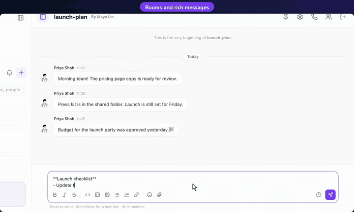
</p>

Every decision your team makes ends up in a chat: your plans, your customers, your code. Relack gives you the team chat you expect on a machine you control. Rooms, threads, calls, search and an admin console run on your own computer or server, and the history sits in one SQLite file beside one folder of uploads.

## Why Relack

Hosted chat is rented. The rent, the rules and the locks belong to someone else, and the last two years showed what that means. The [three-minute film](https://youtu.be/J60fVC0Y5Ys) tells the story.

<p align="center">
  <a href="https://youtu.be/J60fVC0Y5Ys">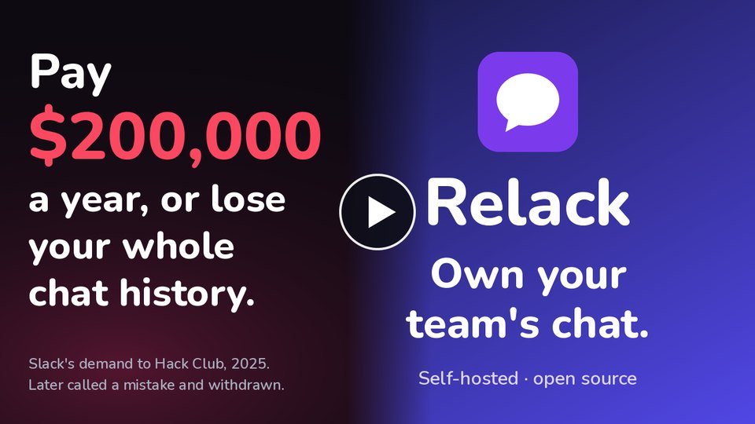</a>
</p>

| What happened on Slack | How it works on Relack |
|---|---|
| **The bill.** In September 2025 Hack Club, a nonprofit paying $5,000 a year, was told to pay $50,000 that week and $200,000 a year or lose its workspace and message history ([The Register](https://www.theregister.com/2025/09/19/slack_nonprofit_license_hike_threat/)). Slack's CEO [called it a mistake](https://news.ycombinator.com/item?id=45283887), apologized and restored the price. In June 2025 Business+ went from $12.50 to $15 per person per month ([TechSpot](https://www.techspot.com/news/108366-salesforce-latest-price-increase-comes-promise-more-ai.html)). Fifty people at the [list price](https://slack.com/pricing) cost $9,000 a year. | There are no seats and no plans. Relack is MIT licensed: you run your own machine, and that's the whole bill. |
| **The off switch.** On April 1, 2026, Slack deactivated workspaces billed in mainland China, Hong Kong and Macau, with deletion to follow within 90 days ([Gizchina](https://www.gizchina.com/tech/slack-terminates-services-across-greater-china-triggering-user-backlash)). | It runs on your machine, so no one far away can switch it off. |
| **The data.** Since May 2025 outside apps may no longer index, copy or keep Slack messages long term, even if the customer permits it ([The Information, via Slashdot](https://tech.slashdot.org/story/25/06/13/1443216/); [Slack API Terms](https://slack.com/terms-of-service/api)). The Free and Pro plans [export public channels only](https://slack.com/help/articles/201658943-Export-your-workspace-data). | Your history is a SQLite file and a folder you hold. **Admin → Export Data** saves every room, private rooms and direct messages included; the files stay in that folder. |
| **Your messages.** Slack's systems analyze customer messages for its global models unless a workspace owner [emails to opt out](https://slack.com/trust/data-management/privacy-principles). Slack says generative AI is trained on customer data only with opt-in. | There are no global models, and Relack sends your messages to no AI. How long messages are kept is a number you set. |

Slack is good software, and none of this is about how well it works. It's about who decides. Many organizations also don't want internal conversations and trade secrets on third-party servers, often in other jurisdictions, where they can be exposed to data breaches, foreign access or surveillance. Run inside your own infrastructure, Relack keeps that information with you, without giving up a modern chat.

## Install it from the Agentic App Store

The quickest way to run Relack is the [Agentic App Store](https://milochen0418.github.io/re_ddns/): an open-source store that runs on your own computer, installs apps from GitHub with one click and gives each one its own HTTPS address.

1. Get the store. It needs Docker on a Mac or Linux host; [one script](https://github.com/milochen0418/re_ddns#quick-start-run-from-zero) sets up everything:
   ```bash
   git clone https://github.com/milochen0418/re_ddns.git
   cd re_ddns
   ./rerun_from_zero.sh
   ```
2. Open `https://aapps.reflex-ddns.com`, find **Relack** and press **Install**.
3. Choose an admin passcode. Google sign-in is optional: leave its fields empty and everyone joins with a nickname.
4. Watch the progress bar, then press **Open**. Your team chat is at `https://relack.reflex-ddns.com`, and the other computers on your network [join with one script](https://github.com/milochen0418/re_ddns).

<table>
  <tr>
    <td>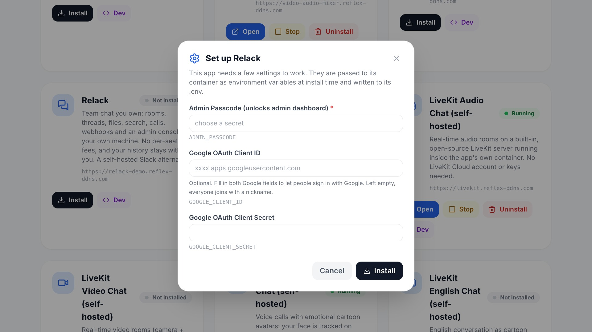</td>
    <td>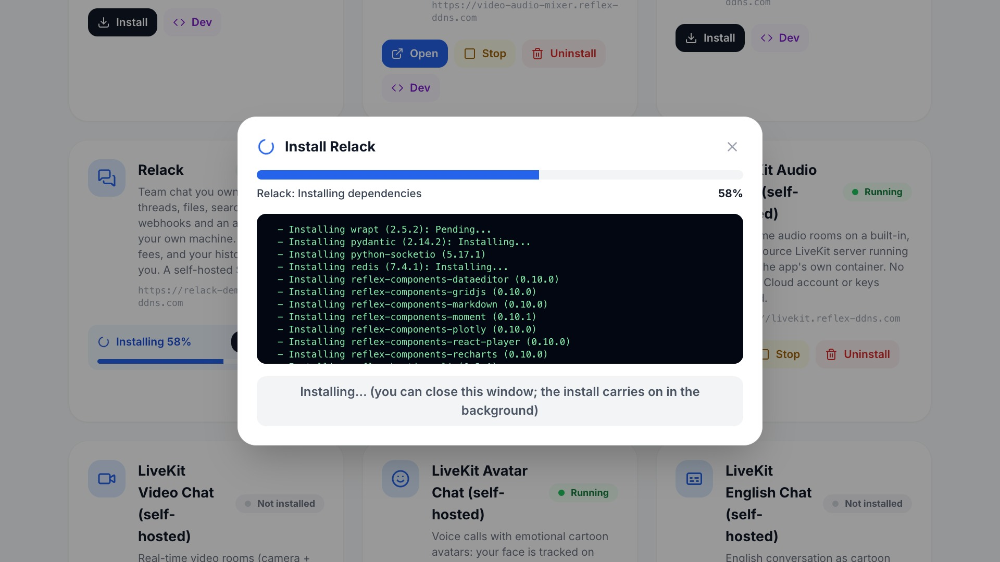</td>
  </tr>
</table>

To run it without the store, see [Run it from source](#run-it-from-source).

## What you get

| | |
|---|---|
| **Rooms** | Public rooms, private rooms, direct messages and group messages |
| **Messages** | Markdown, code blocks, link previews, reactions, threads, editing and deleting |
| **Mentions** | `@name`, `@here`, `@channel`, unread counts, desktop notifications and a sound |
| **Files** | Attach, paste or drop, up to 200 MB per file; pictures show in the message |
| **Search** | Messages, files and people, across every room you can see |
| **Later** | Pins, saved messages, reminders and scheduled messages |
| **Calls** | Ring a room or a person; the call keeps running while you work |
| **Automation** | Incoming webhooks and slash commands |
| **Admin** | Approval, permissions, audit log, message retention, export of every room, and import |
| **Anywhere** | English and 中文, dark mode, phones and the home screen |
| **Sign-in** | Guest nicknames, and Google accounts if you set them up |

## A tour

Every screen below comes from a running Relack. The people and messages are made up.

Messages land on every screen at once: here three people on four screens, one of them a phone, with a build bot joining in.

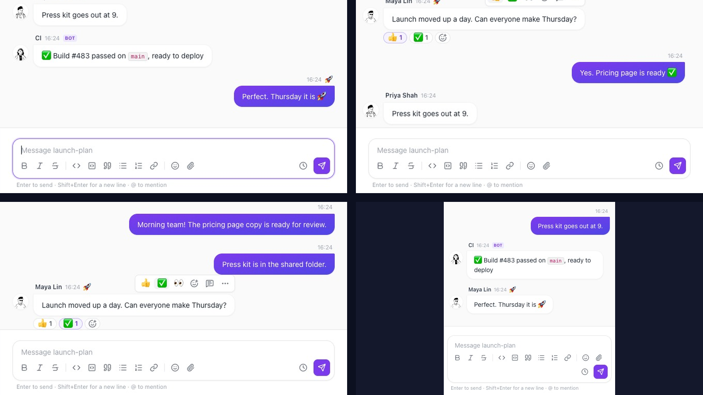


### Rooms and rich messages

Public rooms, private rooms and direct messages sit in one list. Write in Markdown or use the toolbar under the box: bold text, lists and code blocks just look right. Input methods work too: Enter never sends while a Chinese word is still being composed.

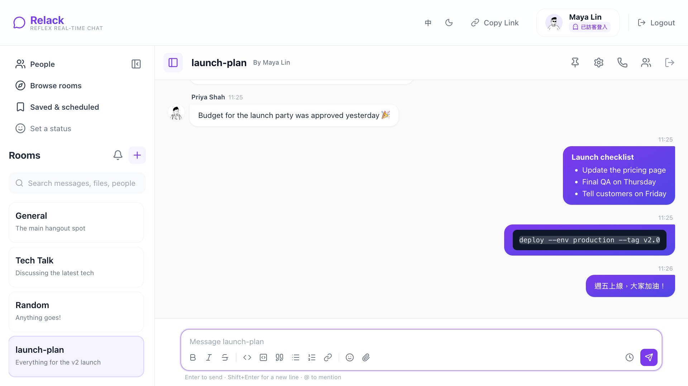

### Mentions and notifications

Type `@` and pick a name. They get a badge on the room, a sound and a desktop notification. `@here`, `@channel` and `@everyone` reach the whole room.

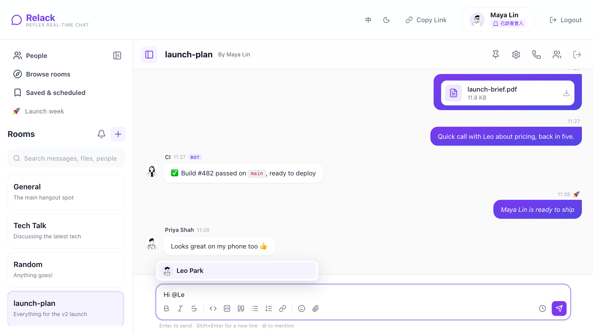

### Reactions and threads

A reaction says "got it" in one tap. Replies go into a side panel, so the main room stays calm.

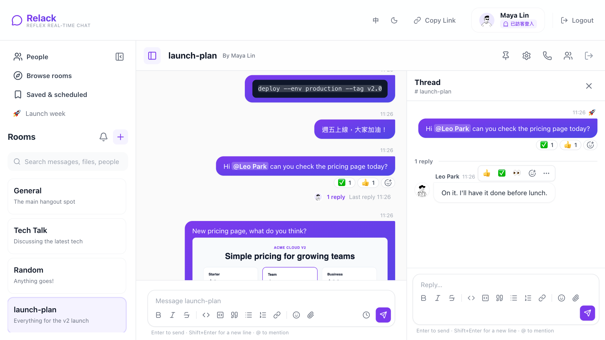

### Files and pictures

Attach a file, paste a screenshot or drop it on the room. Pictures show in the message and open in a viewer; other files become a card that downloads them.

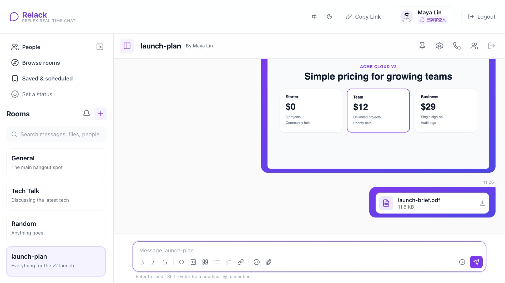

### History and search

Nothing gets lost. Rooms keep their whole history, and search finds messages, files and people in every room you can see. A click takes you straight to the message.

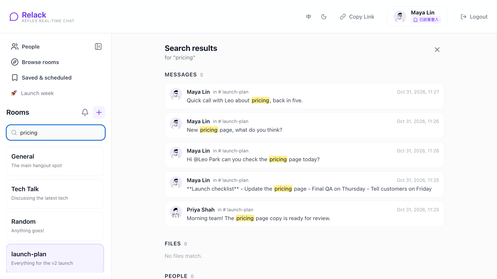

### Pins, reminders and scheduled messages

The `⋯` menu on a message pins it to the room, saves it for later, sets a reminder, forwards it or copies a link to it. The clock beside Send schedules a message, and **Saved & scheduled** lists everything waiting.

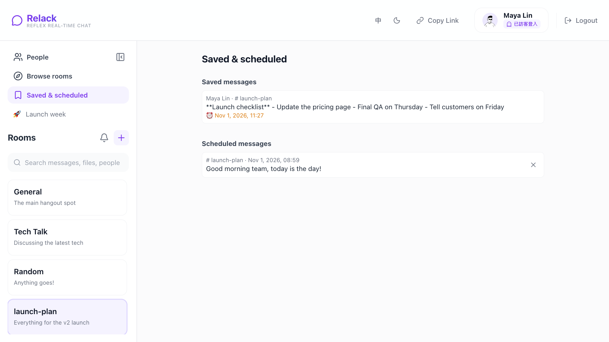

### Calls

Start a call from any room or direct message and everyone gets rung. The call runs in a separate call app, such as the self-hosted [LiveKit audio chat](https://github.com/milochen0418/reflex_ddns_livekit_audio_chat), and keeps running in a small tray while you go back to work. See [Calls](#calls) for the details.

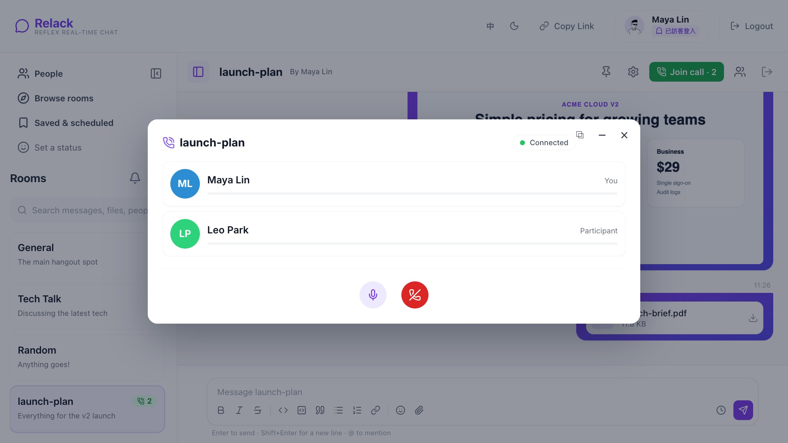

### Webhooks and slash commands

Your tools can post into a room. Create a webhook in the room's settings, then send it JSON:

```bash
curl -X POST https://your-server/api/relack/hooks/<token> \
  -H "Content-Type: application/json" \
  -d '{"text": "✅ Build #482 passed on `main`, ready to deploy"}'
```

Commands such as `/status 🌴 On holiday`, `/later 2h text` and `/dnd 1h` keep your hands on the keyboard; `/help` lists them all.

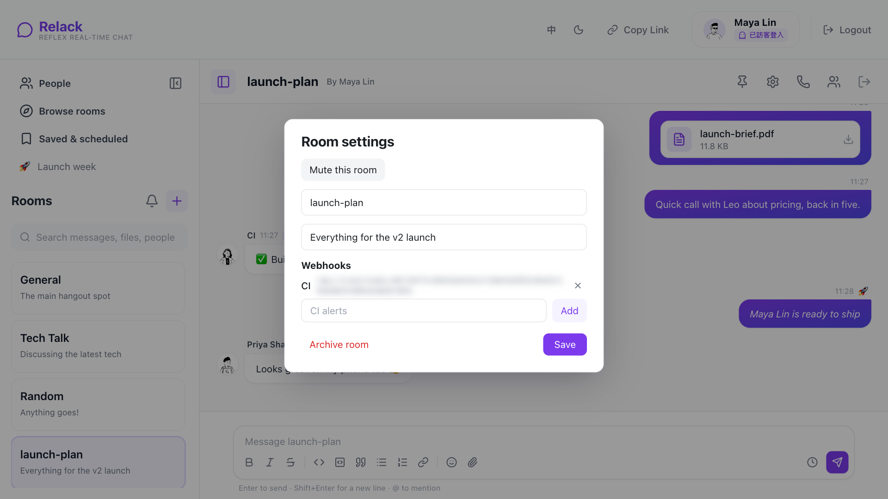

### Admin controls

Everything is open until you tighten it. Decide who gets in and who can create rooms, see who did what in the audit log, and set how long messages are kept.

<table>
  <tr>
    <td>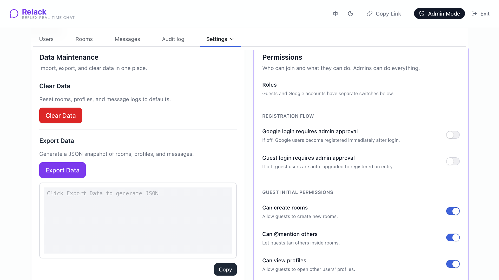</td>
    <td>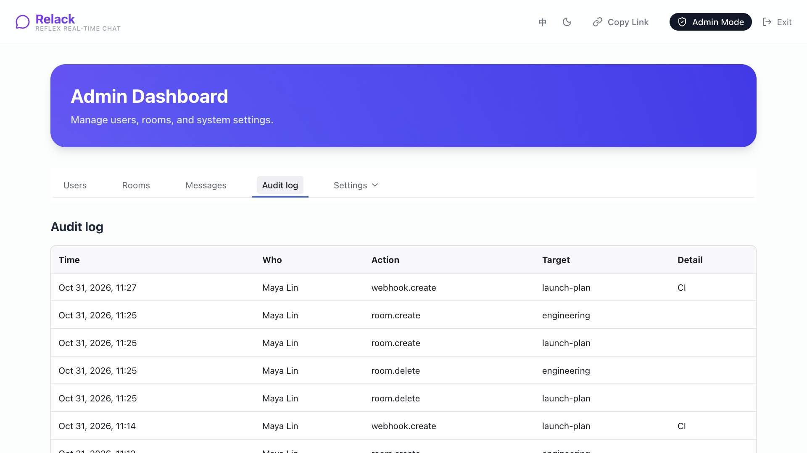</td>
  </tr>
</table>

### Your way, on any screen

English and 中文, light and dark, desktop and phone. The site can also be added to a phone's home screen.

<table>
  <tr>
    <td width="42%">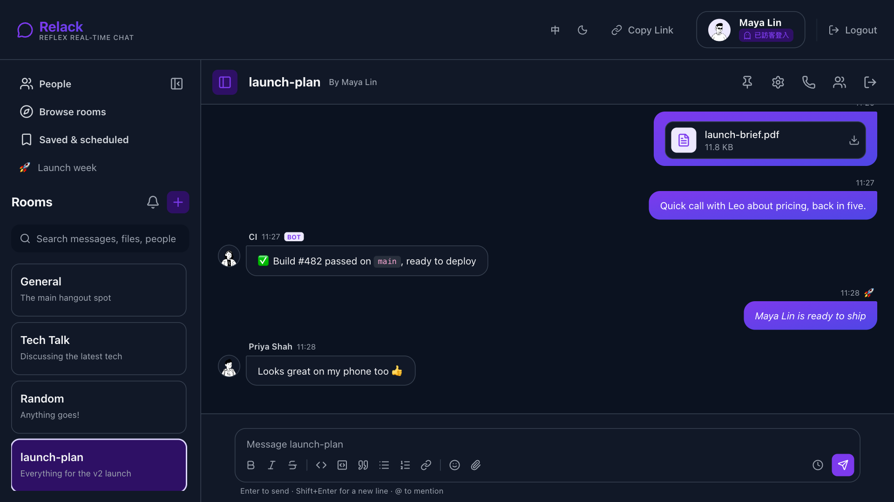</td>
    <td width="42%">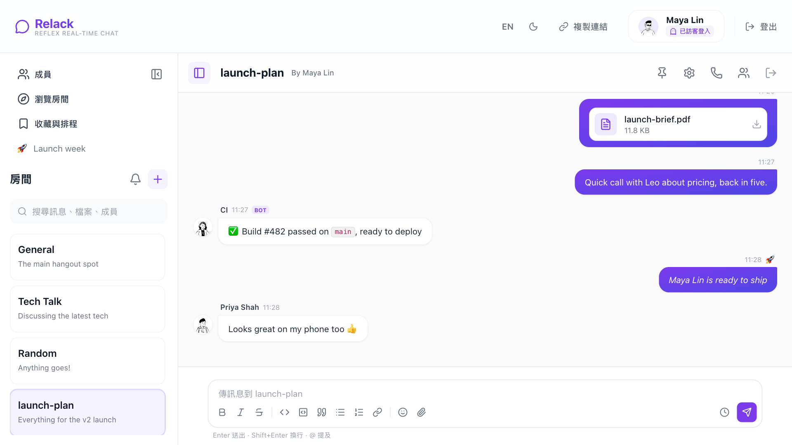</td>
    <td width="16%">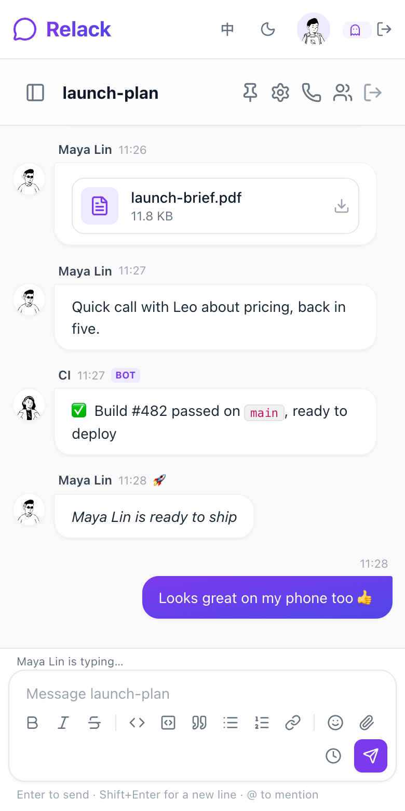</td>
  </tr>
</table>

### Sign in your way

Guests join with a nickname in seconds, and Google accounts keep a permanent profile.

<table>
  <tr>
    <td></td>
    <td>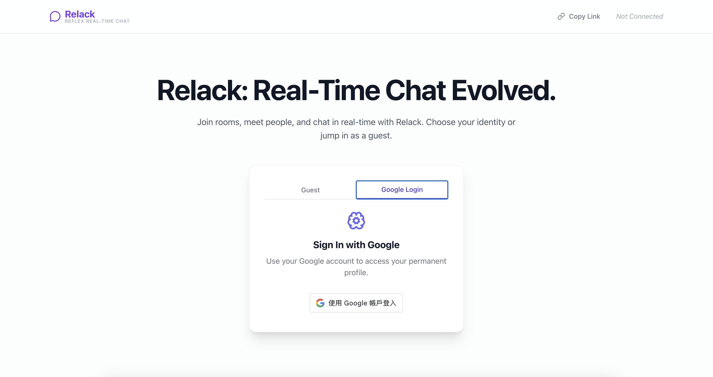</td>
  </tr>
</table>

### Better with the rest of the store

Relack lives beside the other apps in the [Agentic App Store](https://milochen0418.github.io/re_ddns/), and they work together:

- **Calls** come from the call app you install next to it. If you have several, whoever starts the call picks one.
- **Links become cards.** Paste a link from another app and the chat shows what's behind it. A [Snake Duel](https://github.com/milochen0418/snake_duel) room shows the board and who's in; one click and you're playing.
- **One sign-in.** Someone signed in to Relack is already signed in to the other apps on the same store.

<table>
  <tr>
    <td>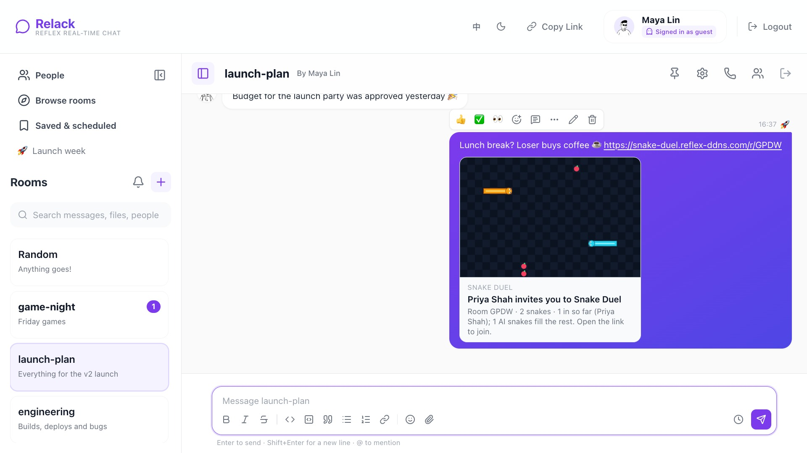</td>
    <td>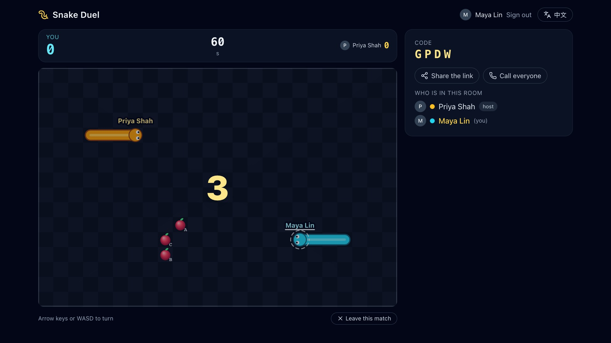</td>
  </tr>
</table>

## What Relack doesn't do yet

Better you hear it here than find out after moving your team:

- No importer for a Slack export, so your old history stays where it is.
- No push notifications to a closed phone app. Desktop notifications work while a tab is open, and the site can be added to a phone's home screen.
- Sign-in is guest nicknames and Google accounts: no SAML or LDAP. Guests have no password, so turn on approval under **Settings → Permissions** if people you don't know can reach the site.
- Incoming webhooks and built-in slash commands only: no bots that answer back, and no app marketplace of its own.
- No shared channels between organizations.
- One machine and one SQLite file, with no clustering. Messages are stored unencrypted on that machine and files are protected by unguessable addresses, so keep the machine safe and back it up.

## Run it from source

This project is managed with [Poetry](https://python-poetry.org/).

### Prerequisites

- Python 3.15 (`pyproject.toml` allows 3.11 – 3.15)
- Poetry

### Installation

1. Clone the repository:
   ```bash
   git clone https://github.com/milochen0418/relack.git
   cd relack
   ```

2. Install dependencies:
   ```bash
   poetry env use python3.15
   poetry install
   ```

### Environment variables (.env)

Copy the template and fill in the values before running the app:

```bash
cp .env.template .env
```

Set these in `.env`:

- `GOOGLE_CLIENT_ID` / `GOOGLE_CLIENT_SECRET` (optional: without them the sign-in page offers guest nicknames only)
   1) In Google Cloud Console, create OAuth 2.0 credentials → Web application.
   2) Authorized JavaScript origins: add `http://localhost:3000` (plus your deploy domain later).
   3) Authorized redirect URIs: add `http://localhost:3000/auth/google/callback` (plus your deploy domain later).
   4) Paste the client ID/secret into `.env`. Wrong or missing values will raise "Invalid audience" during Google login. Reference: https://github.com/masenf/reflex-google-auth
- `ADMIN_PASSCODE`: Any secret string you define. It unlocks the in-app admin dashboard (via the "Administrator Settings" link). Keep it private and change it for your environment.

### Running the App

Start the development server (via Poetry env):

```bash
poetry run reflex run
```

The application will be available at `http://localhost:3000`.

For quick restarts during development (kills anything on ports 3000/8000, then restarts Reflex):

```bash
poetry run ./reflex_rerun.sh
```

<details>
<summary>Python version help (common first-run issue)</summary>

If you see an error like `Current Python version (3.x) is not allowed by the project (>=3.11,<3.16)`, point Poetry at a 3.15 interpreter and retry:

macOS (Homebrew Python 3.15):

```bash
brew install python@3.15
poetry env use /opt/homebrew/bin/python3.15
poetry install
```

If you already have `python3.15` on your PATH (e.g., from an existing install), you can simply run:

```bash
poetry env use python3.15
poetry install
```

After switching, rerun the server:

```bash
poetry run reflex run
```

</details>

## Messages

- **History**: rooms, messages, people, settings and logins are kept in a SQLite database, `relack.db`, so they survive restarts. A room opens with its latest 100 messages; **Load earlier messages** goes further back. Times show in each viewer's own time zone, with a divider where the day changes.
- **Writing**: Enter sends, Shift+Enter starts a new line (Enter never sends while an input method such as Zhuyin is still composing), and Enter inside a ` ``` ` block adds a line. Messages are Markdown: `**bold**`, `_italic_`, `~~strike~~`, `` `code` ``, ` ``` ` code blocks, `>` quotes and lists; the toolbar under the box (and Ctrl/Cmd+B, Ctrl/Cmd+I) adds the marks for you. Links show a preview as before.
- **Reactions, threads, edit, delete**: hover a message for quick reactions, the emoji picker, **Reply in thread** (replies open in a side panel; the message shows how many replies it has), and, on your own messages, **Edit** (shows "(edited)") and **Delete**. A deleted message that has replies stays as "This message was deleted." until its last reply goes.
- **Files**: attach files with the paperclip, paste a screenshot into the box, or drop files on the room. They wait above the box until you send. Pictures show in the message; other files as a card that downloads them. Files are stored under `uploaded_files/relack/` at unguessable addresses (anyone holding a link can open it). The limit is 200 MB per file (`RELACK_MAX_UPLOAD_MB`).
- **Search**: the box above the room list filters rooms as you type; Enter searches messages, files and people in every room you can see. Clicking a message opens it in its room (or thread), highlighted.
- **Mentions and notifications**: type `@` to pick someone (or `@here`, `@channel`, `@everyone` for everyone who has opened the room). Unread counts belong to the person, not the browser tab: the room list shows them (red for mentions and direct messages) and the tab title shows the total. Direct messages, mentions and replies in threads you started or replied in also bring a desktop notification and a sound; the bell above the room list turns them on or off for that browser.

A guest's nickname is their identity, so it can't contain `@` (Google accounts are their email address), be "System" (owner of the default rooms) or be a member's username. Room names starting with `dm-` are kept for direct messages. Import, export and approvals need the admin passcode.

Where `relack.db` lives: in the App Store, beside the app's `reflex.db` on its own volume (SQLite files must not be shared with the host); run locally, in `.relack/` (which the dev server's hot reload ignores). `RELACK_DB_PATH` sets another place. **Admin → Data Maintenance → Export Data** saves everything except the files themselves.

<details>
<summary>E2E suites</summary>

E2E suites:

```bash
poetry run ./run_test_suite.sh chat_messages      # formatting, IME, reactions, threads, edit, delete, history
poetry run ./run_test_suite.sh chat_notify        # @mentions, unread counts, notifications
poetry run ./run_test_suite.sh chat_files_search  # attach, paste, drop, search
poetry run ./run_test_suite.sh chat_persistence   # restart with Reflex's state files deleted
poetry run ./run_test_suite.sh chat_guards        # guest names, dm- names, look-alike rooms
poetry run ./run_test_suite.sh chat_rules         # permissions, approval, audit log
poetry run ./run_test_suite.sh chat_rooms         # rename, leave, mute, archive, webhooks, commands
poetry run ./run_test_suite.sh chat_later         # pin, save, remind, forward, links, scheduling
poetry run ./run_test_suite.sh chat_presence      # status, typing, language, dark mode, phones
poetry run ./run_test_suite.sh chat_layout        # every panel opens and closes at 10 screen widths
```

`chat_messages` replaces all data through the admin import (like `private_room` and `people_intent`), so run the suites against a test server.

</details>

## Rooms, people and admin

- **Rooms**: the gear in a room's header renames it, edits its description, adds or removes members of a private room, mutes it for you, manages webhooks and archives it (read-only, restored from **Browse rooms**). **Browse rooms** also leaves and rejoins public rooms. **New room → Group message** starts a direct message with several people.
- **Message menu (⋯)**: pin to the room, save for later, remind me, forward, copy a link to the message. **Saved & scheduled** lists saved and scheduled messages; the clock beside Send schedules a message.
- **Status**: a status with an emoji shows beside your messages; pausing notifications holds them back (reminders still come). "Who is typing" shows above the box.
- **Commands**: `/help`, `/shrug`, `/me`, `/later 2h text`, `/mute`, `/unmute`, `/leave`, `/status 🌴 text`, `/dnd 1h`, `/topic text`, `/rename name`, `/archive`.
- **Webhooks**: `POST /api/relack/hooks/<token>` with `{"text": "..."}` (optionally `"username"`) posts in the room; each room's settings create and delete them. Anyone holding the address can post, so treat it as a password.
- **Admin**: everything is open until the admin tightens it under **Settings → Permissions** (approval, creating rooms, mentions, profiles; guests and Google accounts apart). A Google account can be made an admin in **Users**: no passcode needed, can delete anyone's messages and rooms, and only admins can use **Clear DB**. **Audit log** records logins, room, member and admin actions; **Message retention** deletes messages and their files after a number of days.
- **Interface**: the top bar switches English / 中文 and dark mode for that browser. Below 768 px wide the room list is a drawer (close it with its button, a tap beside it or Esc); below 1100 px threads and online users slide over the chat. Phones get a one-column layout; the site can be added to the home screen. Push notifications to a closed phone app are not included.

## Calls

Every room (public, private, or direct message) has a call button in its header. The call itself runs in a separate call app, opened in a dialog through the DDNS Intent `call.join`. relack doesn't name the call app: it uses whichever installed app provides `call.join`, as reported by the re-ddns intent registry (for example the self-hosted [LiveKit audio chat](https://github.com/milochen0418/reflex_ddns_livekit_audio_chat) at `livekit.reflex-ddns.com`).

- **Choosing the call app**: if several apps provide `call.join` (e.g. audio, video and avatar chat), whoever starts the call chooses one. The call keeps that choice: everyone who answers or joins later goes straight into the same app, without being asked, because calls in different apps can't reach each other. The next call is chosen afresh.
- **Who gets rung**: everyone who can see the room for private rooms and direct messages, and the people who have it open for public rooms. A popup offers Accept / Decline for about 45 seconds. After that, a room in a call shows a green badge in the sidebar and a **Join call** button in its header.
- **Keeps running**: other dialogs (People → Pick member, profiles…), the **–** button, a click outside the call or Escape minimize the call to a tray at the bottom left; you keep talking while you use relack, including on other pages such as profiles. Click the tray (or **Join call**) to bring it back.
- **Picture-in-picture**: drag the tray's bar along the bottom to move it. Drag it up and it becomes a small window of the call, showing the call as it looks in full, view only: its buttons don't respond. Click the window to bring the call back, drag its corner to resize it, or push it down to the bottom to turn it back into the bar. The window stays where you left it, also after a reload.
- **Leaving**: hanging up, the call's **×** (in the dialog or the tray), or starting another call takes you out of the call. The call ends when its last person leaves.
- **Privacy**: each call gets a random id, so the call of a private room can't be guessed from its name. The id is passed to the call app privately (by postMessage), so it never appears in the dialog's URL.

<details>
<summary>Settings and E2E suites</summary>

Settings (all optional):

- `DDNS_INTENT_PROVIDER_CALL_JOIN`: the app(s) that handle `call.join` when there is no registry, e.g. `livekit` for local development. Any app implementing the intent works; see the [contract](https://github.com/milochen0418/reflex_ddns_livekit_audio_chat#-calls-from-other-apps-ddns-intent-calljoin).
- `DDNS_INTENT_URL_LIVEKIT`: where that app runs, for local development (e.g. `http://localhost:3200`).
- `RELACK_CALL_APP`: always use this app, skipping the registry.

E2E suite (the call app must be running at `DDNS_INTENT_URL_LIVEKIT`, on media ports that are free locally):

```bash
DDNS_INTENT_PROVIDER_CALL_JOIN=livekit DDNS_INTENT_URL_LIVEKIT=http://localhost:3200 \
DDNS_INTENT_URL_RELACK=http://localhost:3000 poetry run ./run_test_suite.sh call_intent
```

Choosing among several call apps: the same call app also stands in as a second one, `livekit-alt`, reached at `127.0.0.1` (another origin):

```bash
DDNS_INTENT_PROVIDER_CALL_JOIN=livekit,livekit-alt DDNS_INTENT_URL_LIVEKIT=http://localhost:3200 \
DDNS_INTENT_URL_LIVEKIT_ALT=http://127.0.0.1:3200 poetry run ./run_test_suite.sh call_app_choice
```

The minimized call's bar and picture-in-picture window:

```bash
DDNS_INTENT_PROVIDER_CALL_JOIN=livekit DDNS_INTENT_URL_LIVEKIT=http://localhost:3200 \
poetry run ./run_test_suite.sh call_pip
```

</details>

## Architecture & Design

Interested in how Relack is built? Check out our [Project Design and Architecture Overview](docs/Relack%20Project%20Design%20and%20Architecture%20Overview.pdf).

## License

MIT. See [LICENSE](LICENSE).

Slack is a trademark of Salesforce, Inc. Relack is an independent project, not affiliated with or endorsed by Slack or Salesforce.
